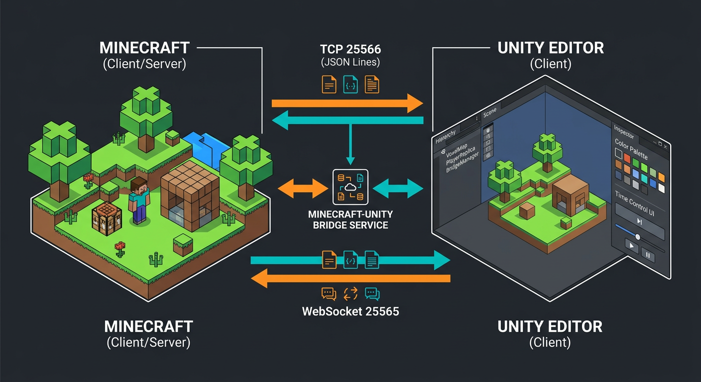

# 🌉 Minecraft → Unity Ponte

> **Construa no Minecraft, veja na Unity em tempo real. E controle tudo de volta pela Unity.**

Um sistema completo de ponte bidirecional entre Minecraft (Fabric) e Unity. Você constrói no Minecraft e a construção aparece instantaneamente na Unity como blocos 3D. Pela Unity você pode **pintar blocos, deletar, preencher áreas, mudar o tempo e o clima, teleportar o player e até conversar no chat** — tudo ao vivo.



```
┌─────────────┐         TCP 25566 / WebSocket 25565         ┌─────────────┐
│  MINECRAFT  │ ──────── JSON Lines ────────────────────────►│    UNITY    │
│  Fabric Mod │ ◄─────── comandos + setBlock/time ───────── │   C# Client │
└─────────────┘         Protocolo Ponte v1.0               └─────────────┘
        ▲                                                        │
        │ grava .json                                            │ instancia
        ▼                                                        ▼
   construções.json                                         WorldBuilder
```

---

## ✨ Funcionalidades

| Categoria | O que faz |
|-----------|-----------|
| **Sincronização Tempo Real** | Todo `place`/`break` de bloco é enviado instantaneamente para a Unity |
| **Sync Inicial** | Ao conectar, a Unity recebe todos os chunks num raio de 8 chunks do player |
| **Pintar Blocos** | Seletor de cor na Unity → converte automaticamente para `concrete`/`wool`/`terracotta` da cor mais próxima |
| **Deletar / Preencher** | Clique para remover, arraste para preencher áreas (fill) com qualquer bloco |
| **Controle de Tempo** | Slider dia/noite na Unity → `time set` no Minecraft |
| **Controle de Clima** | Botões Sol / Chuva / Tempestade |
| **Chat Bidirecional** | Mensagens do Minecraft aparecem na Unity e vice-versa |
| **Teleporte** | Clique num bloco na Unity → teleporta o player no Minecraft |
| **Exportar Construção** | Salva seleção como `.json` para reimportar offline |
| **Multi-cliente** | Vários Unitys podem conectar simultaneamente |

---

## 📦 Estrutura do Repositório

```
MINECRAFT/
├── minecraft-mod/          # Mod Fabric (Java 17) — o lado Minecraft
├── unity-package/          # Pacote Unity (C#) — o lado Unity
├── protocol/               # Definição do protocolo JSON
├── relay/                  # Relay Node.js opcional (WebSocket → TCP)
└── docs/                   # Guias detalhados
```

---

## 🚀 Quick Start

### 1. Minecraft — Instalar o Mod

**Requisitos:** Minecraft 1.20.1, Fabric Loader 0.14+, Fabric API, Java 17.

```bash
cd minecraft-mod
./gradlew build
# jar gerado em build/libs/minecraft-unity-ponte-1.0.0.jar
# copie para sua pasta mods/
```

Inicie o mundo. No log você verá:

```
[Ponte] Servidor TCP iniciado na porta 25566
[Ponte] Servidor WebSocket iniciado na porta 25565
```

> Configuração em `config/minecraft-unity-bridge.json` (porta, raio de sync, permissões).

### 2. Unity — Importar o Pacote

1. Abra Unity 2021.3+ (URP recomendado)
2. `Window > Package Manager > + > Add from disk` → selecione `unity-package/package.json`
3. Arraste o prefab `BridgeManager` para a cena
4. Configure IP (default `127.0.0.1`) e porta `25566` no Inspector
5. Play ▶ — blocos começam a aparecer!

Ou copie manualmente a pasta `unity-package/Runtime` para `Assets/MinecraftBridge/`.

### 3. Relay Opcional (para rede externa / WebGL)

```bash
cd relay
npm install
npm start
# relay escuta em ws://0.0.0.0:25565 e repassa para tcp 127.0.0.1:25566
```

---

## 🎮 Como Usar (Unity)

Após conectar:

- **Visão do mundo:** use `WASD + mouse` (FlyCamera já inclusa) para navegar na réplica
- **Selecionar bloco:** clique esquerdo num bloco
- **Pintar:** escolha cor na paleta → clica no bloco → ele vira `concrete` daquela cor no Minecraft também!
- **Deletar:** botão `Deletar` ou tecla `Delete` → bloco vira ar nos dois lados
- **Preencher:** modo `Fill` → arraste do ponto A ao B → preenche com material selecionado
- **Tempo:** slider `0 - 24000` (0 = amanhecer, 6000 = meio-dia, 13000 = pôr-do-sol, 18000 = meia-noite)
- **Clima:** botões ☀️ / 🌧️ / ⛈️
- **Teleporte:** `Ctrl + Clique` teleporta o player do Minecraft para aquele bloco
- **Chat:** digite no painel e envie → aparece no chat do Minecraft

---

## 🧠 Como Funciona

1. **Mod Fabric** abre um `ServerSocket` TCP (linha-a-linha JSON) + WebSocket.
2. Via **Mixin** em `ServerWorld.setBlockState` ele intercepta toda mudança de bloco.
3. Envia `blockUpdate` / `blockBulk` para todos os clientes Unity conectados.
4. No `PlayerJoin`, envia `chunkData` dos chunks já carregados.
5. **Unity** (`MinecraftBridgeClient.cs`) mantém `Dictionary<Vector3Int, BlockData>` e instancia prefabs via `WorldBuilder`.
6. Ações na Unity geram mensagens inversas (`setBlock`, `setTime`, etc.) que o mod executa via `server.execute()` na thread principal.

Veja `protocol/PROTOCOL.md` para especificação completa.

---

## 📚 Documentação

- [Instalação Detalhada](docs/INSTALACAO.md)
- [Guia de Uso](docs/USO.md)
- [Protocolo da Ponte](protocol/PROTOCOL.md)
- [API para Desenvolvedores](docs/API.md)

---

## 🔧 Configuração

`config/minecraft-unity-bridge.json` (criado automaticamente):

```json
{
  "tcpPort": 25566,
  "webSocketPort": 25565,
  "syncRadiusChunks": 8,
  "maxClients": 8,
  "enableTimeControl": true,
  "enableWeatherControl": true,
  "enableTeleport": true,
  "allowCommands": true,
  "requireOpForUnityActions": false,
  "blockUpdateThrottleMs": 16
}
```

---

## 🗺️ Roadmap

- [ ] Suporte a entidades (mobs, players como avatares)
- [ ] Sincronização de inventário
- [ ] Texturas custom via `resource pack` hash
- [ ] Suporte a Forge/NeoForge
- [ ] Gravação e replay de construções

---

## ⚽ Extra: Ragdoll do Craque (sandbox da foto)

Em [`ragdoll-sandbox/`](ragdoll-sandbox/) tem um joguinho onde uma foto vira um
**boneco ragdoll articulado**: dá pra mexer os braços, mudar ele de lugar,
explodir TNT, usar o fundo de Minecraft e tirar foto da pose.
É só rodar `python3 -m http.server 8000` dentro da pasta e abrir no navegador —
detalhes no [README de lá](ragdoll-sandbox/README.md).

---

## 📄 Licença

MIT — use livremente, mencione a ponte 🌉

Feito com ❤️ para a comunidade BR de Minecraft + Unity.
