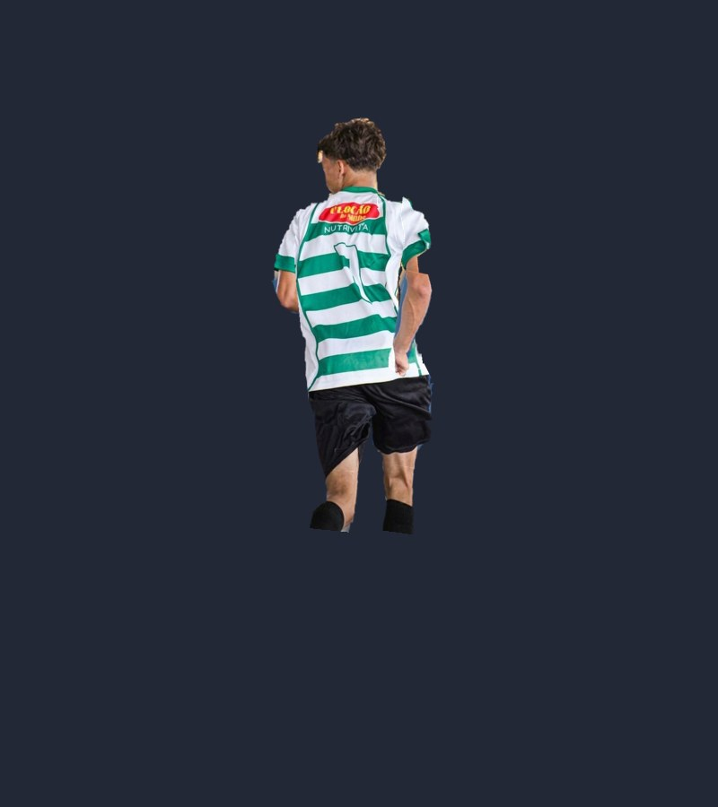

# ⚽ Ragdoll do Craque — Sandbox da Foto

Um joguinho sandbox onde **a foto virou um boneco ragdoll de verdade**:
recortei o jogador da foto, fatiei em cabeça, tronco, braços e pernas
articulados (com física!) — dá pra **arrastar os braços, jogar ele longe,
mudar ele de lugar, explodir TNT nele e tirar foto da pose**.

## ▶️ Como jogar (abrir o jogo)

Na pasta `ragdoll-sandbox/`:

```bash
python3 -m http.server 8000
```

E abre **http://localhost:8000** no navegador (funciona no celular também 📱).
> Também dá pra abrir o `index.html` direto, mas pelo servidor é garantido.

## 🎮 O que dá pra fazer

| Coisa | Como |
|---|---|
| ✋ **Arrastar e jogar ele** | Ferramenta mão: pega qualquer parte do corpo e solta voando |
| 🧍 **Mexer os braços / montar pose** | Botão **Modo Pose**: a física congela — arrasta um braço/perna/cabeça pra **girar na junta**, arrasta o tronco (ou o céu) pra **mudar ele de lugar** |
| 🎭 **Poses prontas** | Em pé, Correndo (a pose da foto!), Comemorando GOOOL, Chutão, Espacate, Voando, Dançando, Dormindo |
| 🧸 **Brincar de sandbox** | Solta ⚽ bolas, 📦 caixas, 🟩 blocos de grama, 🧨 TNT (explode em 3s, em corrente!), 💥 explosões, 🏗️ rampas desenhadas com o dedo/mouse, 🛝 trampolim |
| 🌍 **Mudar o mundo** | Fundos: quadra azul, a foto original, ⛏️ Minecraft, 🚀 espaço, 🏖️ praia, estúdio • Gravidade: zero/Lua/Terra/Júpiter • Câmera lenta 🐢 • Tamanhos até GIGANTE |
| 😜 **Adesivos** | 😎👑🏆🔥 caem na cena (no Modo Pose dá pra colar na cara dele) |
| 📸 **Editar e baixar a foto** | Filtros (P&B, sépia, cores vivas…), texto de meme em cima/embaixo e botão pra baixar o PNG |

⌨️ Atalhos: `1–9` ferramentas • `P` modo pose • `Espaço` pausar • `R` resetar •
botão direito apaga um objeto • no Modo Pose, a rodinha do mouse gira o membro devagarinho.

## 🧩 Como foi feito

1. **`tools_recortar.py`** — o MediaPipe recorta o jogador do fundo
   (`assets/jogador-recortado.png`) e detecta as articulações
   (ombros, cotovelos, joelhos…) em `assets/juntas.json`.
2. **`tools_fatiar.py`** — fatia o recorte em 10 peças com polígonos
   (`assets/pecas/*.png`), limpa o pedaço do pilar amarelo que vazou no
   recorte e gera o `pecas.js` com o centro e a junta (pivot) de cada peça.
3. **`index.html`** — o jogo: física com **Matter.js** (em `lib/`, sem precisar
   de internet), cada peça é um corpo físico ligado por juntas nas
   articulações de verdade, desenhado no Canvas com o PNG da foto.
   A pose inicial e as poses prontas usam cinemática direta (FK) a partir do tronco.
4. **`tests/sim_test.js`** — teste sem navegador: monta o ragdoll igual ao jogo,
   derruba, explode e arrasta pela mão conferindo que nenhuma junta desmonta.
   Rodar: `node tests/sim_test.js` ✅

Pra refazer as peças (ex.: com outra foto): troca `assets/foto-original.png`,
ajusta os polígonos no `tools_fatiar.py` e roda os dois scripts em ordem
(dentro desta pasta; precisa de `mediapipe==0.10.14`, `opencv-python-headless` e `Pillow`).


