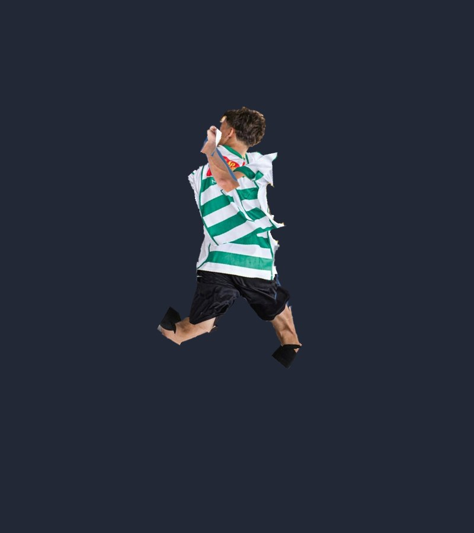

# ⚽ Ragdoll do Craque — Sandbox da Foto (2.0)

Um joguinho sandbox onde **a foto virou um boneco ragdoll de verdade**:
recortei o jogador da foto e fatiei em **16 peças ligadas por 15 articulações
com física** (pescoço, coluna em 2 partes, cotovelos, pulso, joelhos,
tornozelos…) — dá pra **arrastar os braços, jogar ele longe, explodir TNT,
montar poses, fazer ele DANÇAR no estilo TweenSlop do TikTok e gravar o vídeo**!

## ▶️ Como jogar (abrir o jogo)

Na pasta `ragdoll-sandbox/`:

```bash
python3 -m http.server 8000
```

E abre **http://localhost:8000** no navegador (funciona no celular também 📱).

## 🎮 O que dá pra fazer

| Coisa | Como |
|---|---|
| ✋ **Arrastar e jogar ele** | Ferramenta mão: pega qualquer uma das 16 peças e solta voando |
| 🧍 **Mexer os braços / montar pose** | **Modo Pose**: a física congela — arrasta um membro pra **girar na junta**, arrasta o peito (ou o céu) pra **mudar ele de lugar** |
| 📱 **Modo TweenSlop (TikTok)** | Ele **dança sozinho** no estilo tweening dos edits: poses ligadas por **keyframes com graphs** (bounce, elastic, "slop"), squash & stretch, trilhas, zoom no beat, **phonk sintetizado** (bumbo + chimbal + cowbell via WebAudio), moldura **9:16** com interface fake do TikTok, modo **12 FPS slop** e botão **⏺️ Gravar** que baixa o **vídeo com som** (MP4/WebM) pronto pra postar |
| 💪 **Física 2.0** | Simulação a **120 Hz**, soldador mais forte, **limite em cada junta** (pescoço não gira 360° 👻), **tônus muscular** ajustável (gelatina ↔ durão segurando a pose) e **auto-colisão** (o braço esbarra na perna em vez de atravessar) |
| 🌑 **Sombras** | Sombra projetada no chão/plataformas que **afasta e clareia conforme ele voa**, + sombrinha de contato em cada peça (botão pra desligar) |
| 🎭 **Poses prontas** | Em pé, Correndo (a pose da foto!), Comemorando GOOOL, Chutão, Espacate, Voando, Dançando, Dormindo |
| 🧸 **Sandbox** | ⚽ bolas, 📦 caixas, 🟩 blocos de grama, 🧨 TNT (explode em 3s, em corrente!), 💥 explosões, 🏗️ rampas desenhadas, 🛝 trampolim, adesivos 😎👑🏆 |
| 🌍 **Mudar o mundo** | Fundos: quadra, foto original, ⛏️ Minecraft, 🚀 espaço, 🏖️ praia, estúdio • Gravidade zero/Lua/Terra/Júpiter • Câmera lenta • Tamanhos até GIGANTE |
| 📸 **Foto** | Filtros, texto de meme e download em PNG |

⌨️ Atalhos: `1–9` ferramentas • `P` pose • `T` tweenslop • `Espaço` pausar • `R` resetar •
botão direito apaga objeto • no Modo Pose, a rodinha do mouse gira o membro devagarinho.

## 🧩 Como foi feito

1. **`tools_recortar.py`** — o MediaPipe recorta o jogador do fundo
   (`assets/jogador-recortado.png`) e detecta as articulações (`assets/juntas.json`).
2. **`tools_fatiar.py`** — fatia o recorte nas **16 peças** (`assets/pecas/*.png`)
   com polígonos sobrepostos nas juntas e gera o `pecas.js` (centro + junta de cada peça).
3. **`index.html`** — o jogo: **Matter.js** (em `lib/`, offline) a 120 Hz com
   iterações extras do solver; cada junta tem **limite angular** aplicado por
   correção geométrica + "músculos" (mola angular pro alvo da última pose);
   **auto-colisão** via uma categoria de colisão por peça (mãe/filha e vizinhas
   coladas na foto não colidem, o resto bate); **sombras** = silhuetas das peças
   pré-geradas, projetadas achatadas na superfície abaixo (chão ou plataforma,
   achada por varredura das bounds estáticas) com alfa/deslocamento pela altura.
   O **TweenSlop** é uma máquina de keyframes: interpola os ângulos entre poses
   com easings (outBack/outElastic/outBounce/…), apoia os pés no chão por bounds,
   e o gravador usa `canvas.captureStream` do recorte 9:16 + a saída do WebAudio
   (`MediaStreamDestination`) num `MediaRecorder` — por isso o beat vai junto no vídeo.
4. **`tests/sim_test.js`** — teste sem navegador: monta o ragdoll igual ao jogo,
   derruba, explode, arrasta pela mão e confere juntas (esticada, limites,
   filtros de auto-colisão). Rodar: `node tests/sim_test.js` ✅

Pra refazer as peças (ex.: com outra foto): troca `assets/foto-original.png`,
apaga `assets/.limpo`, ajusta os polígonos no `tools_fatiar.py` e roda os dois
scripts em ordem (nesta pasta; precisa de `mediapipe==0.10.14`, `opencv-python-headless`, `Pillow`).



